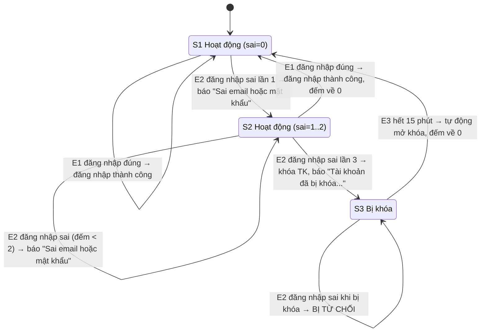

# BUỔI 2 – CHUYỂN TRẠNG THÁI: ĐĂNG NHẬP VÀ KHÓA TÀI KHOẢN

- **Họ tên:** Phạm Thanh Bình
- **MSSV:** 65130239
- **Yêu cầu liên quan:** FR-02.1, FR-02.2, FR-02.3, FR-02.4

## 1. Trạng thái và sự kiện

| Ký hiệu | Trạng thái | Mô tả |
|---|---|---|
| S1 | Hoạt động (sai = 0) | Tài khoản hoạt động bình thường, bộ đếm sai = 0 |
| S2 | Hoạt động (sai = 1 hoặc 2) | Tài khoản hoạt động, đã sai 1 hoặc 2 lần liên tiếp |
| S3 | Bị khóa | Tài khoản bị khóa sau 3 lần sai liên tiếp, trong vòng 15 phút |

| Ký hiệu | Sự kiện |
|---|---|
| E1 | Đăng nhập đúng (email và mật khẩu đúng) |
| E2 | Đăng nhập sai (email hoặc mật khẩu sai) |
| E3 | Hết 15 phút kể từ khi bị khóa |

## 2. Sơ đồ chuyển trạng thái

Điền vào khối dưới đây. GitHub sẽ tự vẽ sơ đồ trong Pull Request.

## 3. Bảng chuyển đổi

Điền trạng thái đích cho mọi ô. Ô nào là chuyển đổi bị từ chối hoặc không hợp lệ thì ghi rõ trong cột ghi chú.

| Trạng thái hiện tại | E1 (đăng nhập đúng) | E2 (đăng nhập sai) | E3 (hết 15 phút) | Ghi chú |
|---|---|---|---|---|
| S1 (sai=0) | → S1: đăng nhập thành công, đếm giữ 0 | → S2: đếm sai = 1, báo "Sai email hoặc mật khẩu" | Không áp dụng | S1+E3: TK không bị khóa nên E3 không xảy ra |
| S2 (sai=1..2) | → S1: đăng nhập thành công, đếm về 0 (FR-02.3) | Nếu đếm < 2 → S2 (đếm tăng); Nếu đếm = 2 → S3 (khóa TK) | Không áp dụng | S2+E3: TK chưa bị khóa nên E3 không xảy ra |
| S3 (bị khóa) | → S3: từ chối, báo "Tài khoản đã bị khóa, vui lòng thử lại sau 15 phút" (FR-02.4) | → S3: từ chối, báo "Tài khoản đã bị khóa, vui lòng thử lại sau 15 phút" | → S1: tự động mở khóa, đếm về 0 (FR-02.4) | S3+E1 và S3+E2 đều bị từ chối |

#### 4. Ánh xạ sang ca kiểm thử
| Chuyển đổi | Hợp lệ? | Mã ca |
|---|---|---|
| S1→S1 (E1: đăng nhập đúng, đếm=0) | Có | TC-65130239-29 |
| S1→S2 (E2: sai lần 1) | Có | TC-65130239-30 |
| S2→S2 (E2: sai lần 2, đếm tăng) | Có | TC-65130239-31 |
| S2→S3 (E2: sai lần 3, khóa TK 15 phút) | Có | TC-65130239-32 |
| S2→S1 (E1: đăng nhập đúng, reset đếm về 0) | Có | TC-65130239-33 |
| S3→S1 (E3: hết 15 phút, tự động mở khóa) | Có | TC-65130239-34 |
| S3→S3 (E1: đúng MK khi bị khóa – BỊ TỪ CHỐI) | Không | TC-65130239-35 |
| S3→S3 (E2: sai MK khi bị khóa – BỊ TỪ CHỐI) | Không | TC-65130239-36 |

Số chuyển đổi hợp lệ: **6** · Số chuyển đổi đã phủ: **6** · Độ phủ: **100%**  
Số ca cho chuyển đổi không hợp lệ (bị từ chối): **2**
