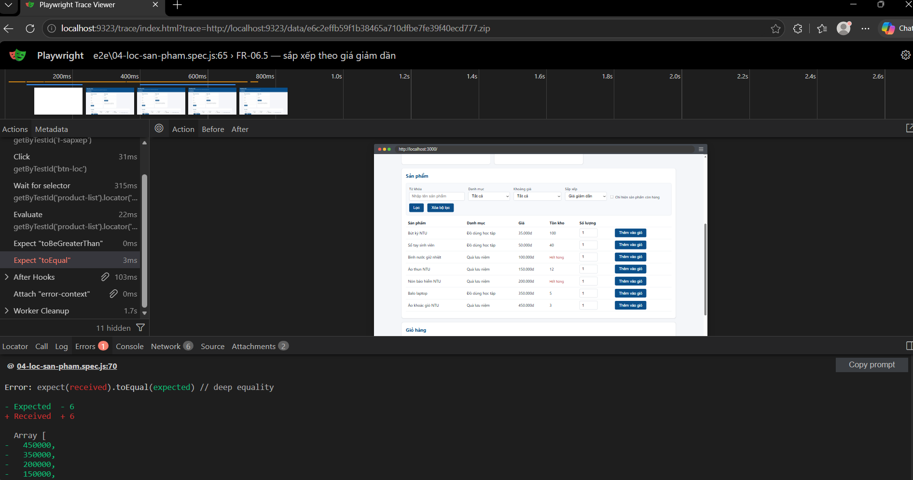

# BUỔI 5 – BÁO CÁO KIỂM THỬ TỰ ĐỘNG GIAO DIỆN

- **Họ tên:** Phạm Thanh Bình
- **MSSV:** 65130239
- **Phiên bản phần mềm:** MiniShop NTU v1.1.0
- **Tài liệu yêu cầu:** SRS v1.2

## 1. Tổng hợp kết quả chạy `npm run e2e`

| Chỉ số | Giá trị |
|---|---|
| Tổng số ca E2E | 22 ca (21 ca chạy, 1 ca bỏ qua) |
| Số ca đạt | 18 |
| Số ca thất bại | 3 |
| Thời gian chạy toàn bộ | ~45s |

So sánh với việc chạy tay ở Buổi 4: cùng số lượng kịch bản tương đương (khoảng 20 kịch bản kiểm thử giao diện bao gồm đăng ký, đăng nhập, kiểm tra giỏ hàng, tính phí, đặt hàng và lọc sản phẩm theo nhiều tổ hợp tiêu chí), nếu thực hiện thủ công bằng tay trên trình duyệt sẽ mất khoảng 25 đến 30 phút (do phải mở từng trang, gõ dữ liệu, bấm nút, quan sát kết quả và ghi chép báo cáo). Kiểm thử tự động E2E với Playwright chỉ mất khoảng 43 giây, nhanh gấp hơn 35 lần và có thể chạy lại bất cứ lúc nào một cách hoàn toàn tự động và chính xác.

## 2. Các ca đã tự động hóa ở Phần 1

| Mã ca Buổi 2 | Yêu cầu (SRS v1.2) | Tên ca E2E | Kết quả |
|---|---|---|---|
| TC-65130239-01 | FR-01.3 | FR-01.3 — đăng ký với tuổi 17 bị từ chối | Pass |
| TC-65130239-32 | FR-02.3 | FR-02.3 — khóa tài khoản sau 3 lần sai | Pass |
| TC-65130239-26 | FR-04.3 | FR-04.3 — VIP miễn phí vận chuyển ở ngoại thành | Pass |
| TC-65130239-22 | FR-04.1 | TC-65130239-22 — FR-04.1: thành viên thường ngoại thành tính đúng tổng tiền kèm phí vận chuyển | Fail |

## 3. Lựa chọn locator

Với **ba** phần tử bất kỳ đã dùng trong bài, ghi lại lựa chọn và lý do.

| Phần tử | Locator đã dùng | Vì sao chọn cách này thay vì cách khác |
|---|---|---|
| Nút Đăng nhập | `page.getByTestId('btn-login')` | Sử dụng test id chuẩn được định nghĩa sẵn trong mã nguồn HTML của MiniShop, ổn định và không bị phụ thuộc vào việc thay đổi text hiển thị trên nút hoặc cấu trúc thẻ bọc. |
| Thanh chào người dùng | `page.getByTestId('user-bar')` | Tránh dùng selector theo id CSS thông thường `#user-bar` hoặc XPath; `getByTestId` bám sát thuộc tính kiểm thử của dự án, dễ bảo trì. |
| Bảng sản phẩm | `page.getByTestId('product-list').locator('table')` | Kết hợp `getByTestId` với thẻ `table` bên trong để chờ phần tử dạng web-first assertion ngay khi bảng kết quả được render xong, tránh dùng wait cứng theo thời gian. |

**Câu hỏi:** nếu lập trình viên đổi nhãn nút "Đăng nhập" thành "Vào hệ thống", những ca kiểm thử nào của mình sẽ gãy? Nếu đổi thuộc tính `data-testid` thì sao?
- Nếu lập trình viên đổi nhãn nút thành "Vào hệ thống": Các ca kiểm thử của mình KHÔNG bị gãy, vì toàn bộ mã kiểm thử đang sử dụng `getByTestId('btn-login')` chứ không phụ thuộc vào text hiển thị của nhãn nút (`getByRole('button', { name: 'Đăng nhập' })`).
- Nếu lập trình viên đổi thuộc tính `data-testid` (ví dụ thành `nut-dang-nhap`):
  - Trong file có dùng Page Object (`03-pom.spec.js`), chỉ cần sửa đúng 1 dòng khai báo trong `LoginPage.js` là toàn bộ ca test chạy lại bình thường.
  - Trong các file không dùng Page Object (`01-luong-chinh.spec.js`, `02-flaky.spec.js`), tất cả các ca có gọi trực tiếp `getByTestId('btn-login')` sẽ bị gãy và phải vào từng file để sửa lại.

## 4. Kết quả kiểm thử hồi quy FR-06 (Phần 4)

| Yêu cầu | Tên ca E2E | Kết quả mong đợi | Kết quả thực tế | Pass/Fail |
|---|---|---|---|---|
| FR-06.2 | FR-06.2 — lọc theo từ khóa không phân biệt hoa thường | Hiển thị 2 sản phẩm chứa từ "áo": Áo thun NTU, Áo khoác gió NTU | Hiển thị đúng 2 sản phẩm mong đợi | Pass |
| FR-06.4 | FR-06.4 — lọc theo khoảng giá 100k-300k bao gồm hai đầu mút | Hiển thị 3 sản phẩm trong khoảng 100k-300k: Áo thun NTU, Bình nước giữ nhiệt, Nón bảo hiểm NTU | Hiển thị đúng 3 sản phẩm | Pass |
| FR-06.5 (tăng dần) | FR-06.5 — sắp xếp theo giá tăng dần | Danh sách sắp xếp giá tăng dần từ 35.000đ đến 450.000đ | Sắp xếp đúng thứ tự giá tăng dần | Pass |
| FR-06.5 (giảm dần) | FR-06.5 — sắp xếp theo giá giảm dần | Danh sách sắp xếp giá giảm dần từ 450.000đ về 35.000đ | Danh sách vẫn sắp xếp theo giá tăng dần | Fail |
| FR-06.6 | FR-06.6 — chỉ hiện sản phẩm còn hàng | Chỉ hiển thị 5 sản phẩm có tồn kho lớn hơn 0, không chứa sản phẩm "Hết hàng" | Hiển thị toàn bộ 7 sản phẩm (vẫn bao gồm 2 sản phẩm "Hết hàng") | Fail |
| FR-06.7 (tổ hợp) | FR-06.7 — áp dụng đồng thời từ khóa, danh mục, khoảng giá và tồn kho | Hiển thị đúng 1 sản phẩm: Bút ký NTU | Hiển thị đúng sản phẩm Bút ký NTU | Pass |
| FR-06.7 (không kết quả) | FR-06.7 — tổ hợp tiêu chí không có kết quả hiển thị thông báo phù hợp | Danh sách trống và hiển thị thông báo "Không tìm thấy sản phẩm phù hợp." | Hiển thị đúng thông báo "Không tìm thấy sản phẩm phù hợp." | Pass |

## 5. Phân tích các ca thất bại

Với mỗi ca thất bại trong toàn bộ bài, điền một dòng. Phân loại nguyên nhân giống Buổi 3 và Buổi 4: **LỖI MÃ NGUỒN**, **LỖI CA KIỂM THỬ**, hoặc **YÊU CẦU CHƯA RÕ**.

| Tên ca E2E | Kết quả mong đợi | Kết quả thực tế | Phân loại | Căn cứ (SRS v1.2) |
|---|---|---|---|---|
| TC-65130239-22 — FR-04.1: thành viên thường ngoại thành tính đúng tổng tiền kèm phí vận chuyển | Tổng tiền khi đặt hàng là 335.000đ (Tạm tính 300.000đ + Phí ship ngoại thành 35.000đ) | Thông báo hiển thị tổng tiền là 300.000đ (chưa cộng phí vận chuyển) | LỖI MÃ NGUỒN | SRS v1.2 mục FR-04.1 và UC-03: Tổng tiền thanh toán phải bằng Tạm tính − Giảm giá + Phí vận chuyển |
| FR-06.5 — sắp xếp theo giá giảm dần | Danh sách sản phẩm được sắp xếp theo giá giảm dần | Danh sách sản phẩm vẫn bị sắp xếp theo giá tăng dần | LỖI MÃ NGUỒN | SRS v1.2 mục FR-06.5: Người dùng có thể sắp xếp kết quả theo Giá giảm dần |
| FR-06.6 — chỉ hiện sản phẩm còn hàng | Danh sách chỉ gồm sản phẩm có tồn kho lớn hơn 0 (5 sản phẩm, không chứa sản phẩm hết hàng) | Danh sách hiển thị cả 7 sản phẩm, vẫn chứa sản phẩm có tồn kho bằng 0 ("Hết hàng") | LỖI MÃ NGUỒN | SRS v1.2 mục FR-06.6: Khi bật tùy chọn Chỉ hiện sản phẩm còn hàng, danh sách chỉ gồm sản phẩm có tồn kho lớn hơn 0 |

### 5.1. Đối chiếu với Buổi 4

Lỗi nào trong bảng trên đã được phát hiện bằng tay ở Buổi 4? Lỗi nào lần này mới thấy? Nếu có lỗi đã báo ở Buổi 4 mà bộ E2E không bắt được, giải thích vì sao.
- **Lỗi đã phát hiện bằng tay ở Buổi 4:** Lỗi FR-06.6 (bật tùy chọn chỉ hiện sản phẩm còn hàng nhưng sản phẩm hết hàng vẫn xuất hiện) và lỗi FR-06.5 (chọn sắp xếp giá giảm dần nhưng kết quả hiển thị vẫn sắp xếp tăng dần) đã được phát hiện trong phiên kiểm thử khám phá (Exploratory Testing) ở Buổi 4.
- **Lỗi lần này mới thấy:** Lỗi đặt hàng không cộng phí vận chuyển vào tổng tiền ở `TC-65130239-22`. Ở Buổi 4 chỉ bấm nút "Tính phí vận chuyển" (thấy thông báo tính phí ship đúng) mà không bấm nút "Đặt hàng" để kiểm tra giá trị `total` của đơn hàng được lưu trong hệ thống.
- Bộ E2E tái hiện tự động và chính xác 100% các lỗi trên trong chưa đầy 1 phút mà không cần người dùng phải bấm tay lại từng bước.

## 6. Dùng Trace Viewer

Chọn **một** ca thất bại, mở dấu vết bằng lệnh mà Playwright gợi ý ở cuối kết quả chạy:

```
npx playwright show-trace test-results/<thư-mục-ca-thất-bại>/trace.zip
```

| Mục | Nội dung |
|---|---|
| Ca kiểm thử đã xem | `tests/e2e/04-loc-san-pham.spec.js` › `FR-06.6 — chỉ hiện sản phẩm còn hàng` |
| Bước nào thất bại | Bước khẳng định `expect(tonKho).not.toContain('Hết hàng')` |
| Ảnh chụp màn hình tại thời điểm đó cho thấy điều gì | Ảnh chụp màn hình cho thấy trên bảng sản phẩm vẫn còn dòng sản phẩm "Bình nước giữ nhiệt" và "Nón bảo hiểm NTU" với cột Tồn kho hiển thị chữ "Hết hàng" màu đỏ, dù checkbox "Chỉ hiện sản phẩm còn hàng" đang được tích chọn. |
| Thông tin nào trong Trace Viewer hữu ích nhất khi tìm nguyên nhân | Tab Network và Source/Console: xem được phản hồi API `/api/products?conHang=co` trả về mảng 7 phần tử, qua đó thấy ngay mã nguồn backend `src/server.js` lọc điều kiện `stock >= 0` thay vì `stock > 0`. |

Chèn ảnh chụp màn hình Trace Viewer vào thư mục `bai-nop/hinh/` và dẫn link tại đây.




