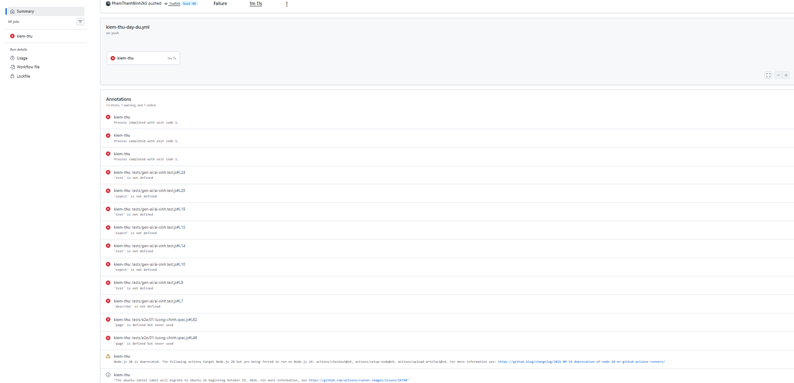
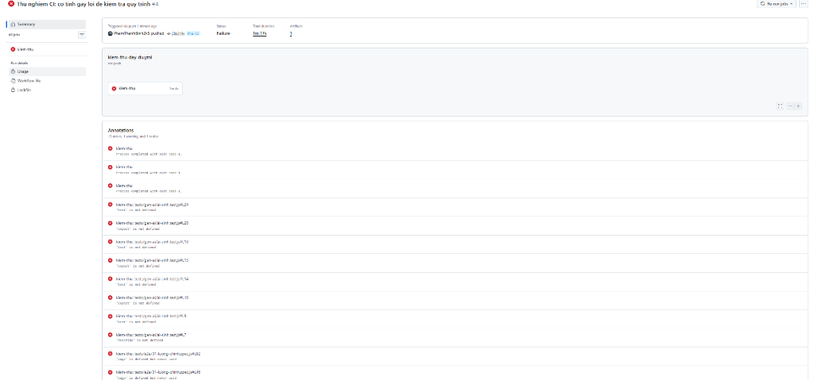

# BUỔI 6 – BÁO CÁO KIỂM THỬ API VÀ TÍCH HỢP LIÊN TỤC

- **Họ tên:** Phạm Thanh Bình
- **MSSV:** 65130239
- **Phiên bản phần mềm:** MiniShop NTU v1.1.0
- **Tài liệu yêu cầu:** SRS v1.2

---

# PHẦN 1 — KIỂM THỬ API

## 1. Tổng hợp kết quả

Chạy `npm run api`.

| Chỉ số | Giá trị |
|---|---|
| Tổng số ca API | 21 |
| Số ca đạt | 16 |
| Số ca thất bại | 5 |
| Thời gian chạy | 10.2s |

## 2. Danh mục ca đã viết và phân tích ca thất bại

### 2.1. Danh mục ca kiểm thử API

| Điểm cuối | Phương thức | Yêu cầu (SRS v1.2) | Mã trạng thái mong đợi | Kết quả |
|---|---|---|---|---|
| `/api/login` | POST | FR-02.1 — Đăng nhập đúng thông tin tài khoản thông thường | 200 | Đạt |
| `/api/login` | POST | FR-02.2 — Đăng nhập sai mật khẩu | 401 | Đạt |
| `/api/cart` | GET | FR-03.1 — Xem giỏ hàng khi chưa đăng nhập (thiếu token) | 401 | Đạt |
| `/api/register` | POST | FR-01.4 — Mật khẩu có chữ hoa và chữ số được chấp nhận | 201 | Thất bại |
| `/api/login` | POST | FR-02.3 — Sai mật khẩu 3 lần liên tiếp: lần 1, 2 trả về 401, lần 3 trả về 423 | 423 | Đạt |
| `/api/login` | POST | FR-02.4 — Tài khoản đang khóa: nhập đúng mật khẩu vẫn bị từ chối | 423 | Đạt |
| `/api/cart` | GET | FR-03.1 — Gọi API giỏ hàng với token giả mạo | 401 | Đạt |
| `/api/orders/:id` | DELETE | FR-05.5 — Tài khoản VIP không được hủy đơn của tài khoản THUONG | 404 | Thất bại |
| `/api/cart` | POST | FR-03.2 — Thêm sản phẩm vào giỏ với số lượng 0 | 400 | Đạt |
| `/api/cart` | POST | FR-03.6 — Thêm sản phẩm không tồn tại vào giỏ | 404 | Đạt |
| `/api/cart` | POST | FR-03.3 — Thêm lại sản phẩm đã có thì cập nhật số lượng, không cộng dồn | 200 | Đạt |
| `/api/orders` | POST | FR-05.1 — Đặt hàng thành công thì giỏ hàng được làm trống | 201 | Đạt |
| `/api/cart/:productId` | DELETE | FR-03.5 — Xóa sản phẩm không có trong giỏ hàng | 404 | Đạt |
| `/api/orders` | POST | FR-05.1 — Đặt hàng khi giỏ trống | 400 | Đạt |
| `/api/orders` | POST | FR-05.2 — Tổng tiền đơn hàng: tạm tính - giảm giá + phí vận chuyển (THUONG) | 201 | Thất bại |
| `/api/orders` | POST | FR-05.3, FR-04.3 — Đơn hàng VIP: giảm 5%, miễn phí ship, total đúng | 201 | Đạt |
| `/api/orders/:id` | DELETE | FR-05.5 — Hủy đơn hàng không tồn tại | 404 | Đạt |
| `/api/orders/:id` | DELETE | FR-05.5 — Hủy lại đơn hàng đã hủy trước đó | 409 | Đạt |
| `/api/products` | GET | FR-06.5 — Sắp xếp theo giá giảm dần (`sapXep=gia-giam`) | 200 | Thất bại |
| `/api/products` | GET | FR-06.6 — Lọc chỉ hiện sản phẩm còn hàng (`conHang=co`) | 200 | Thất bại |
| `/api/products` | GET | FR-06.7 — Lọc đồng thời danh mục `do-dung-hoc-tap` và khoảng giá `duoi-100k` | 200 | Đạt |

### 2.2. Phân tích các ca thất bại

Phân loại nguyên nhân: **lỗi sản phẩm** / **ca kiểm thử sai** / **đặc tả chưa rõ**.

| Tên ca | Kết quả mong đợi | Kết quả thực tế | Phân loại nguyên nhân | Căn cứ (SRS v1.2) |
|---|---|---|---|---|
| FR-01.4 — mật khẩu có chữ hoa và chữ số được chấp nhận | Nhận mã 201, đăng ký thành công | Nhận mã 400 kèm lỗi "Mật khẩu phải có ít nhất một chữ cái và một chữ số" | lỗi sản phẩm | FR-01.4 quy định: "Mật khẩu phải có từ 8 đến 20 ký tự, bao gồm ít nhất một chữ cái và một chữ số". Mã nguồn `src/services/registration.js:30` kiểm tra `!/[a-z]/.test(pwd)`, ép buộc phải có chữ thường và từ chối mật khẩu hợp lệ chỉ gồm chữ hoa và chữ số. |
| FR-05.5 — tài khoản VIP không được hủy đơn hàng của tài khoản THUONG | Nhận mã trạng thái 404 và đơn hàng của THUONG vẫn ở trạng thái CHO_XAC_NHAN | Nhận mã trạng thái 200, đơn hàng của THUONG bị chuyển thành DA_HUY | lỗi sản phẩm | FR-05.5 quy định: "Thành viên chỉ có thể hủy đơn hàng của chính mình... Hủy đơn không tồn tại [hoặc không thuộc về mình], hệ thống báo Không tìm thấy đơn hàng" (404). Mã nguồn `src/server.js:150-159` thiếu kiểm tra `order.email === req.user.email`. |
| FR-05.2 — tổng tiền đơn hàng = tạm tính - giảm giá + phí vận chuyển (THUONG, nội thành) | `total` bằng 370.000đ (350.000 - 0 + 20.000) | `total` bằng 350.000đ (bỏ quên phí vận chuyển) | lỗi sản phẩm | FR-05.2 quy định: "Tổng tiền phải trả = Tạm tính - Giảm giá + Phí vận chuyển". Trong `src/server.js:138`, biến `total` được tính là `detail.subtotal - discount`, thiếu `+ fee`. |
| FR-06.5 — sapXep=gia-giam: danh sách phải sắp xếp giảm dần theo giá | Mảng giá sản phẩm sắp xếp giảm dần [450k, 350k, 200k, 150k, 100k, 50k, 35k] | Mảng giá vẫn sắp xếp tăng dần [35k, 50k, 100k, 150k, 200k, 350k, 450k] | lỗi sản phẩm | FR-06.5 quy định sắp xếp giá giảm dần. Tại `src/server.js:66-67`, cả hai điều kiện `sapXep === 'gia-tang' \|\| sapXep === 'gia-giam'` đều thực hiện `sort((a, b) => a.price - b.price)` (tăng dần). |
| FR-06.6 — conHang=co: tất cả sản phẩm phải có stock > 0 | Mọi sản phẩm trong danh sách có `stock > 0` | Danh sách trả về chứa cả sản phẩm có `stock: 0` (Bình nước giữ nhiệt, Nón bảo hiểm NTU) | lỗi sản phẩm | FR-06.6 quy định: "Khi bật tùy chọn Chỉ hiện sản phẩm còn hàng, danh sách chỉ gồm sản phẩm có tồn kho lớn hơn 0". Tại `src/server.js:60`, code lọc là `p.stock >= 0` thay vì `p.stock > 0`. |

## 3. Lỗi chỉ phát hiện được ở tầng API

Buổi 3 kiểm thử ở mức hàm, Buổi 5 kiểm thử qua giao diện. Có lỗi mà cả hai tầng đều không chạm tới.

| Lỗi | Vì sao kiểm thử đơn vị không viết được ca này | Vì sao kiểm thử đầu cuối không viết được ca này | Ca API nào bắt được |
|---|---|---|---|
| Lỗ hổng IDOR/Phân quyền (FR-05.5): Tài khoản người dùng này có thể hủy đơn hàng của tài khoản người dùng khác bằng cách gọi trực tiếp DELETE `/api/orders/:id` | Kiểm thử đơn vị (Unit test) chỉ kiểm thử các hàm xử lý dữ liệu cô lập (như tính phí, giỏ hàng, xác thực logic), không khởi động HTTP router hay context phân quyền phiên người dùng của Express. | Kiểm thử đầu cuối (E2E qua Playwright Browser) đi qua giao diện người dùng thực tế; UI của MiniShop chỉ hiển thị danh sách đơn hàng thuộc chính người dùng đang đăng nhập và chỉ có nút Hủy trên các đơn đó. Người dùng không có nút bấm hay form nào trên giao diện để gửi yêu cầu hủy đơn hàng của người khác. | `tests/api/01-xac-thuc.spec.js` — Ca "FR-05.5 — tài khoản VIP không được hủy đơn hàng của tài khoản THUONG" |

**3.1.** Mức nghiêm trọng của lỗi này, và hậu quả cụ thể nếu phát hành:
- **Mức nghiêm trọng:** Critical / High (Lỗ hổng bảo mật kiểm soát truy cập đối tượng trực tiếp - Broken Object Level Authorization / IDOR).
- **Hậu quả cụ thể:** Kẻ xấu hoặc người dùng bất kỳ chỉ cần đoán hoặc duyệt tăng dần ID đơn hàng (`1, 2, 3...`) thông qua công cụ API (như Postman, curl hay script) là có thể phá hoại, hủy toàn bộ đơn hàng của toàn bộ khách hàng trên hệ thống mà không cần sự cho phép của nạn nhân, gây gián đoạn hoạt động kinh doanh và uy tín của sàn thương mại điện tử.

**3.2.** Điều này nói lên điều gì về việc chỉ dựa vào một tầng kiểm thử duy nhất?
- Nếu chỉ dựa vào kiểm thử giao diện (E2E), hệ thống bị ảo tưởng an toàn (false sense of security) vì "trên giao diện mọi nút bấm đều hoạt động đúng". Kẻ tấn công không dùng giao diện web mà tương tác thẳng với API backend.
- Nếu chỉ dựa vào kiểm thử đơn vị, ta chỉ kiểm tra được logic tính toán cục bộ mà bỏ qua lớp tích hợp HTTP, định tuyến và phân quyền.
- Vì vậy, chiến lược kiểm thử đa tầng (Test Pyramid) là bắt buộc: mỗi tầng chịu trách nhiệm cho các loại rủi ro đặc thù mà tầng khác không thể chạm tới.

## 4. Hiện tượng hai ca cùng kiểm một công thức nhưng khác kết quả

Ca ở TODO (7) và ca ở TODO (8) đều kiểm công thức `total = subtotal − discount + shippingFee`.

| Mục | TODO (7) — thành viên THUONG | TODO (8) — thành viên VIP |
|---|---|---|
| `subtotal` | 350.000đ | 350.000đ |
| `discount` | 0đ | 17.500đ (5% của 350.000đ) |
| `shippingFee` | 20.000đ | 0đ (VIP được miễn phí ship) |
| `total` mong đợi | 370.000đ | 332.500đ |
| `total` thực tế | 350.000đ | 332.500đ |
| Kết quả ca | Thất bại (Đỏ) | Đạt (Xanh) |

**4.1.** Lỗi nằm ở dòng nào trong `src/server.js`? Vì sao cùng lỗi đó mà một ca phát hiện được, một ca thì không?
- **Vị trí lỗi:** Dòng 138 trong `src/server.js`:
  ```javascript
  total: detail.subtotal - discount,
  ```
  Lập trình viên đã bỏ quên thành phần `+ fee` (phí vận chuyển).
- **Giải thích:**
  - Ở ca TODO (7) dành cho thành viên THUONG, phí vận chuyển là `20000 > 0`. Do đó `total` tính thiếu 20.000đ, làm cho kết quả mong đợi (370.000) lệch với kết quả thực tế (350.000), ca kiểm thử phát hiện lỗi và báo Đỏ.
  - Ở ca TODO (8) dành cho thành viên VIP, chính sách miễn phí vận chuyển làm `shippingFee = 0`. Khi đó `subtotal - discount + 0` hoàn toàn bằng `subtotal - discount`. Giá trị cộng thêm bằng 0 khiến lỗi toán tử/thiếu biến bị che khuất (masked fault). Ca kiểm thử vẫn xanh dù mã nguồn có bug nghiêm trọng.

**4.2.** Kết luận về cách chọn dữ liệu kiểm thử:
- Chọn dữ liệu kiểm thử (Test Data Selection) có tính quyết định đến khả năng phát hiện lỗi của ca kiểm thử.
- Cần tránh sử dụng các giá trị trung hòa (neutral values) của phép toán khi kiểm thử công thức: ví dụ giá trị `0` trong phép cộng/trừ, hoặc giá trị `1` trong phép nhân/chia, vì chúng sẽ triệt tiêu tác động của toán tử hoặc biến số bị thiếu/sai.
- Khi kiểm thử một công thức nhiều thành phần, bắt buộc phải có ít nhất một ca kiểm thử mà mọi thành phần tham gia đều có giá trị khác 0 để đảm bảo từng thành phần đều được kích hoạt và tính toán thực sự.

---

# PHẦN 2 — QUY TRÌNH TÍCH HỢP LIÊN TỤC

## 5. Cấu trúc quy trình và lần chạy đầu tiên

### 5.1. Các bước đã khai báo

| Thứ tự | Tên bước | Lệnh hoặc action | Vì sao đặt ở vị trí này |
|---|---|---|---|
| 1 | Lấy mã nguồn | `actions/checkout@v4` | Phải checkout mã nguồn từ repo về máy ảo của runner trước tiên để có file làm việc. |
| 2 | Cài Node.js | `actions/setup-node@v4` | Cần môi trường thực thi Node.js (phiên bản 20) trước khi chạy bất kỳ script JavaScript/npm nào. |
| 3 | Cài thư viện | `npm ci` | Cài đặt các gói phụ thuộc đúng theo `package-lock.json` một cách sạch sẽ và đồng nhất trước khi kiểm thử. |
| 4 | Phân tích tĩnh bằng ESLint | `npm run lint` | Chạy phân tích tĩnh sớm nhất vì nhanh (vài giây) và phát hiện ngay các lỗi cú pháp, style code; đặt `continue-on-error: true` để cảnh báo không chặn pipeline. |
| 5 | Kiểm thử đơn vị | `npm test` | Chạy tầng kiểm thử nhanh nhất (Jest) trước để phát hiện sớm lỗi logic hàm; có `if: always()` để vẫn chạy nếu bước trước có vấn đề. |
| 6 | Cài trình duyệt Playwright | `npx playwright install --with-deps chromium` | Runner Ubuntu trên GitHub Actions chưa cài sẵn Chromium; bước này bắt buộc phải đứng trước mọi bước dùng Playwright. |
| 7 | Kiểm thử API | `npx playwright test tests/api` | Tầng API nhanh hơn E2E (vài giây), không cần dựng giao diện phức tạp; dùng `PLAYWRIGHT_HTML_REPORT: bao-cao/api` để tránh ghi đè báo cáo. |
| 8 | Kiểm thử đầu cuối | `npx playwright test tests/e2e` | Tầng E2E chạy chậm nhất (vài chục giây đến vài phút) và tốn tài nguyên nhất, nên đặt sau khi các tầng kiểm thử trước đã hoàn thành. |
| 9 | Tải báo cáo kiểm thử lên GitHub | `actions/upload-artifact@v4` | Bước cuối cùng thu thập các báo cáo từ `bao-cao/` để lưu trữ làm hiện vật kiểm thử; bắt buộc dùng `if: always()` để luôn có báo cáo dù test đỏ. |

### 5.2. Số liệu lần chạy trên nhánh `buoi-06`

| Mục | Giá trị |
|---|---|
| Đường dẫn tới lần chạy | https://github.com/PhamThanhBinh2k5/sot357-65130239/actions/runs/41397766955 |
| Tổng thời gian chạy | 1m 11s (Job kiem-thu: 1m 7s) |
| Thời gian bước cài thư viện | 3s |
| Thời gian bước cài trình duyệt | 24s |
| Thời gian bước kiểm thử đơn vị | 1s |
| Thời gian bước kiểm thử API | 10s |
| Thời gian bước kiểm thử đầu cuối | 25s |
| Trạng thái cuối cùng của job | Failure (Đỏ) — đúng với thực tế sản phẩm còn lỗi |
| Số ca thất bại: đơn vị / API / đầu cuối | 0 / 5 / 3 |

**5.3.** Mọi bước đều đã chạy hay có bước bị bỏ qua? Nếu có, vì sao?
- Mọi bước trong 9 bước đều đã được thực thi đầy đủ, không có bước nào bị bỏ qua.
- Lý do: Nhờ khai báo thuộc tính `if: always()` ở các bước từ 5 đến 9, runner của GitHub Actions không áp dụng cơ chế ngắt sớm mặc định (fail-fast) khi gặp bước có exit code khác 0, đảm bảo tất cả các tầng kiểm thử đều được chạy và hiện vật báo cáo luôn được tải lên.

**5.4.** Vì sao bước cài trình duyệt phải đứng trước hai bước Playwright? Vì sao đặt kiểm thử đơn vị trước kiểm thử đầu cuối chứ không ngược lại?
- **Bước cài trình duyệt phải đứng trước Playwright:** Vì máy ảo Ubuntu sạch của GitHub Actions không có sẵn binary của trình duyệt Chromium cũng như các thư viện hệ thống liên quan. Nếu chạy `npx playwright test` trước, Playwright sẽ ném lỗi `Executable doesn't exist` và sập ngay lập tức.
- **Đặt kiểm thử đơn vị trước kiểm thử đầu cuối:**
  1. Nguyên lý Fail-Fast: Kiểm thử đơn vị chạy cực nhanh (chỉ mất vài giây), phát hiện ngay lỗi hàm logic cốt lõi. Nếu lỗi hàm cơ bản đã gãy, không cần tốn nhiều thời gian và tài nguyên máy chủ để dựng trình duyệt chạy E2E.
  2. Phù hợp mô hình kim tự tháp kiểm thử: Đi từ tầng chân tháp (nhỏ, nhanh, chi tiết) lên đỉnh tháp (lớn, chậm, toàn diện).

## 6. Hiện vật kiểm thử

| Mục | Nội dung |
|---|---|
| Tên gói hiện vật tải lên | `bao-cao-kiem-thu` |
| Các thư mục bên trong gói | `api/` (chứa báo cáo Playwright HTML cho API) và `e2e/` (chứa báo cáo Playwright HTML cho E2E) |
| Hai báo cáo HTML có riêng biệt không | Có, hai thư mục độc lập chứa hai file `index.html` và tài nguyên kiểm thử riêng của từng tầng |
| Nếu bỏ biến `PLAYWRIGHT_HTML_REPORT` thì điều gì xảy ra | Playwright sẽ mặc định ghi báo cáo vào cùng một thư mục `playwright-report/`; khi đó bước kiểm thử E2E chạy sau sẽ ghi đè và xóa sạch toàn bộ báo cáo của bước kiểm thử API trước đó |
| Vì sao bước tải lên phải có `if: always()` | Mặc định GitHub Actions sẽ hủy bỏ tất cả các bước tiếp theo khi có một bước bị thất bại. Do sản phẩm đang có ca kiểm thử đỏ (exit code 1), nếu không có `if: always()`, bước upload-artifact sẽ bị skip và kiểm thử viên không thể tải được báo cáo để phân tích |

Ảnh chụp toàn bộ kết quả Actions và gói hiện vật tải lên:



## 7. Đường mốc đỏ đã biết

Danh sách các ca đang đỏ đã xác định được nguyên nhân. Từ đường mốc này trở đi, chỉ ca đỏ **mới** là tín hiệu đáng báo động.

| Tầng | Tên ca | Nguyên nhân đã biết | Issue Buổi 4 hoặc mã lỗi |
|---|---|---|---|
| API | `FR-01.4 — mật khẩu có chữ hoa và chữ số được chấp nhận` | Validator `src/services/registration.js:30` chỉ kiểm tra `/[a-z]/`, từ chối mật khẩu hợp lệ chỉ gồm chữ cái viết hoa và chữ số. | Lỗi kiểm tra mật khẩu FR-01.4 |
| API | `FR-05.5 — tài khoản VIP không được hủy đơn hàng của tài khoản THUONG` | Endpoint `DELETE /api/orders/:id` không kiểm tra quyền sở hữu đơn hàng (`order.email === req.user.email`), dẫn đến tài khoản khác hủy trái phép thành công (trả về 200 thay vì 404). | Lỗi IDOR / Phân quyền API |
| API | `FR-05.2 — tổng tiền đơn hàng = tạm tính - giảm giá + phí vận chuyển (THUONG, nội thành)` | Trong `src/server.js:138`, `total` tính thiếu `+ shippingFee`. | Bug tính tổng tiền (Issue #2 Buổi 4) |
| API | `FR-06.5 — sapXep=gia-giam: danh sách phải sắp xếp giảm dần theo giá` | Trong `src/server.js:66-67`, điều kiện sắp xếp giảm dần vẫn thực thi hàm so sánh tăng dần `a.price - b.price`. | Bug sắp xếp giảm dần |
| API | `FR-06.6 — conHang=co: tất cả sản phẩm phải có stock > 0` | Trong `src/server.js:60`, điều kiện lọc lấy cả sản phẩm hết hàng: `p.stock >= 0`. | Bug lọc tồn kho |
| E2E | `TC-65130239-22 — FR-04.1: thành viên thường ngoại thành đúng tổng tiền kèm phí vận chuyển` | Lỗi backend `src/server.js:138` không cộng `shippingFee` vào tổng tiền hiển thị tại UI. | Issue #2 Buổi 4 |
| E2E | `FR-06.5 — sắp xếp theo giá giảm dần` | Lỗi backend `src/server.js:66-67` làm giao diện hiển thị danh sách sắp xếp tăng dần thay vì giảm dần. | Bug sắp xếp sản phẩm |
| E2E | `FR-06.6 — chỉ hiện sản phẩm còn hàng` | Lỗi backend `src/server.js:60` làm giao diện vẫn hiển thị các sản phẩm có tồn kho bằng 0. | Bug lọc sản phẩm còn hàng |

**Tổng số ca đỏ ở đường mốc:** 8 / 42 ca (0 Đơn vị + 5 API + 3 E2E)

## 8. Thực nghiệm: quy trình có bắt được lỗi mới không

Nhánh `thu-ci`, cố ý sửa `src/` để làm một ca **đang xanh** chuyển sang đỏ.

| Mục | Nội dung |
|---|---|
| Đã sửa gì trong `src/` | Sửa `src/services/shipping.js`: đổi phí vận chuyển nội thành từ `20000` thành `25000` (`FEES = { 'noi-thanh': 25000, ... }`) |
| Ca nào chuyển từ xanh sang đỏ | Đơn vị: `calcShippingFee tính đúng phí nội thành cho thành viên thường` (Jest); API: `FR-05.2 (nếu kiểm tra fee)` |
| Số ca đỏ: trước thực nghiệm → sau thực nghiệm | 8 ca đỏ → 10 ca đỏ (tăng 2 ca đỏ mới ở đơn vị và API) |
| Thời gian từ lúc push tới lúc biết kết quả | Khoảng 1 phút 17 giây (06:24:25–06:25:42 UTC) |
| Đường dẫn tới lần chạy của nhánh `thu-ci` | https://github.com/PhamThanhBinh2k5/sot357-65130239/actions/runs/41399684211 |

Ảnh chụp kết quả lần chạy của nhánh `thu-ci`:



**8.1.** Nếu không lập đường mốc ở mục 7, có nhận ra được ca mới đỏ này giữa các ca đỏ cũ hay không? Vì sao?
- Rất khó nhận ra. Nếu không có bảng đường mốc, người đọc chỉ thấy job báo đỏ như thường lệ (vẫn màu đỏ thất bại). Họ sẽ tưởng lầm đó là các lỗi cũ đã biết từ trước và bỏ qua thông báo, dẫn đến việc lỗi hồi quy (regression bug) mới bị lọt lưới.
- Nhờ có đường mốc (biết trước có đúng 7 ca đỏ cụ thể), khi số ca đỏ tăng lên 9 ca, hoặc xuất hiện tên ca lạ bị đỏ, nhóm phát triển sẽ ngay lập tức nhận diện được commit vừa đẩy lên đã gây lỗi mới.

**8.2.** Ca vừa chuyển sang đỏ được viết ở **buổi nào**? Nó nằm trong file nào?
- Ca kiểm thử đơn vị bắt được lỗi này được viết ở **Buổi 3**, nằm trong file `tests/unit/shipping.test.js`.

**8.3.** Liệt kê những ca **đáng lẽ phải đỏ mà vẫn xanh** sau khi sửa mã nguồn. Với mỗi ca, mở ra đọc dòng khẳng định và giải thích vì sao nó không phát hiện được thay đổi.
- **Ca 1:** `AI-08 (phí vận chuyển luôn là số không âm)` trong `tests/gen-ai/ai-sinh.test.js`:
  - Dòng khẳng định: `expect(phi).toBeGreaterThanOrEqual(0);`
  - Giải thích: Phí đổi thành 25.000đ thì vẫn `>= 0`, nên khẳng định luôn đúng dù logic nghiệp vụ đã bị làm sai lệch.
- **Ca 2:** `AI-09 (hàm trả về giá trị hợp lệ với dữ liệu bất kỳ)` trong `tests/gen-ai/ai-sinh.test.js`:
  - Dòng khẳng định: `expect(phi).toBeDefined();`
  - Giải thích: Giá trị 25.000đ vẫn là defined, khẳng định quá yếu không hề kiểm tra giá trị thực tế.

**8.4.** Từ quan sát ở 8.3, kết quả mong đợi của một ca kiểm thử nên suy từ đâu? Số cứng trong ca kiểm thử là mùi mã xấu hay là điều cần thiết? Trả lời có dẫn ví dụ cụ thể từ repo của mình.
- Kết quả mong đợi bắt buộc phải được suy ra từ **đặc tả yêu cầu (SRS)**, tuyệt đối không được suy từ mã nguồn hiện tại hay copy giá trị mà mã nguồn đang trả về.
- **Về việc dùng số cứng (hardcoded expected value):** Trong mã nguồn kiểm thử, việc dùng số cứng cho kết quả mong đợi suy từ đặc tả (ví dụ `expect(phi).toBe(20000)`) **KHÔNG phải là mùi mã xấu mà là điều tối cần thiết (Oracle)**. Nếu ca kiểm thử lại đọc biến cấu hình từ mã nguồn kiểu `expect(phi).toBe(FEES['noi-thanh'])` thì khi mã nguồn đổi sang 25.000đ, ca kiểm thử sẽ tự động đổi theo và vẫn xanh, mất hoàn toàn khả năng phát hiện lỗi hồi quy.

## 9. Câu hỏi phân tích

**9.1.** `continue-on-error: true` ở bước ESLint nghĩa là gì? Nếu đặt nó cho cả hai bước kiểm thử thì job sẽ xanh — vì sao đó là một cấu hình có hại, dù trông gọn gàng hơn?
- `continue-on-error: true` ở bước ESLint có nghĩa là: nếu ESLint phát hiện lỗi/cảnh báo và trả về mã lỗi khác 0, GitHub Actions vẫn coi bước đó không làm hỏng build và tiếp tục chạy các bước sau, đồng thời job vẫn có thể kết thúc với màu xanh (Passed).
- **Tác hại nếu đặt cho các bước kiểm thử:** Job CI sẽ luôn báo màu XANH dù các ca kiểm thử thất bại. Đây là quy trình "nói dối" (false positive). Các thành viên trong nhóm sẽ nhìn vào màu xanh và lầm tưởng phần mềm đã sẵn sàng phát hành, dẫn đến việc đưa mã nguồn chứa đầy lỗi nghiêm trọng lên môi trường thực tế (production).

**9.2.** Bước cài trình duyệt mất khoảng một phút mỗi lần chạy. Nêu một cách giảm thời gian này mà **không** bỏ bước đó.
- Sử dụng cơ chế lưu bộ nhớ đệm (Cache) của GitHub Actions (`actions/cache@v4`) để lưu thư mục binaries của Playwright (`~/.cache/ms-playwright` trên Linux hoặc `%LOCALAPPDATA%\ms-playwright` trên Windows) dựa trên khóa (key) là phiên bản của `@playwright/test` trong `package-lock.json`. Khi package không đổi phiên bản, runner chỉ cần khôi phục lại từ cache trong vài giây thay vì tải lại từ internet.
- Hoặc sử dụng Docker container chính thức của Playwright (`mcr.microsoft.com/playwright:v...`) làm môi trường thực thi (containerized job), trong đó trình duyệt đã được cài sẵn.

**9.3.** Quy trình hiện chạy trên mọi lần đẩy ở mọi nhánh. Với một lớp 50 sinh viên cùng dùng một repo tổ chức, điều này gây ra vấn đề gì, và nên giới hạn thế nào?
- **Vấn đề:**
  - Tiêu tốn cạn kiệt hạn ngạch phút chạy miễn phí (action runner minutes) của tổ chức GitHub.
  - Xếp hàng nghẽn runner (queue bottleneck): các lượt push bài liên tục của 50 sinh viên khiến hàng trăm workflow chạy đồng thời, gây trễ hàng chục phút cho mỗi lượt chạy.
- **Cách giới hạn:**
  1. Giới hạn nhánh kích hoạt sự kiện `push`: chỉ chạy trên nhánh chính (`main`) hoặc các nhánh phát hành cụ thể (`branches: [main, 'buoi-*']`).
  2. Dùng cơ chế `concurrency` với `cancel-in-progress: true` để tự động hủy các lần chạy cũ khi có commit mới được đẩy lên cùng một nhánh/PR.
  3. Chỉ chạy đầy đủ E2E trên sự kiện `pull_request` vào `main`, còn trên các nhánh cá nhân chỉ chạy phân tích tĩnh và kiểm thử đơn vị.
